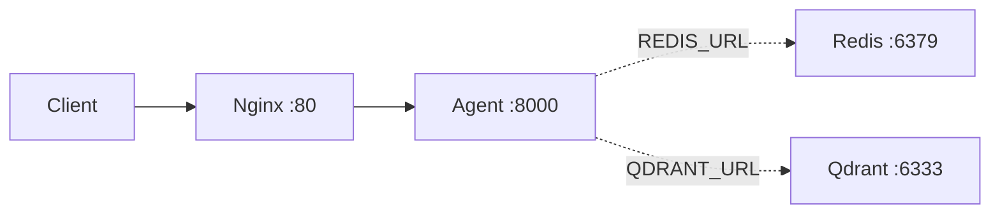

# Day 14 — Mission Answers

## Part 1 — Localhost vs Production

### Exercise 1.1
Các anti-pattern trong `01-localhost-vs-production/develop/app.py`:
1. Hardcode API key giả và database URL/password.
2. In API key, câu hỏi và câu trả lời ra log.
3. DEBUG/MAX_TOKENS và port cố định trong code.
4. Bind localhost khiến container không nhận traffic từ ngoài.
5. reload=True luôn bật.
6. Thiếu health/readiness và lifecycle cleanup.

### Exercise 1.2
Đã chạy app develop bằng uvicorn trên cổng 8011 và gọi:
`curl.exe -i -X POST "http://127.0.0.1:8011/ask?question=Hello"`.
Output thực tế nằm ở phần Bằng chứng HTTP bên dưới. Develop nhận query, không nhận JSON.

### Exercise 1.3
| Feature | Develop | Production | Ý nghĩa |
|---|---|---|---|
| Config | Hardcode | Settings/env | Một image dùng nhiều môi trường |
| Secrets | Literal, in ra log | Env | Tránh lộ key qua Git/log |
| Host/port | localhost:8000 | HOST/PORT | Chạy được trong container/cloud |
| Health | Không có | /health, /ready | Tách còn sống và sẵn sàng |
| Log | print | logging | Gom, lọc và truy vết |
| Shutdown | Không cleanup | lifespan | Dọn connection |
| Reload | Luôn bật | Theo DEBUG | Chỉ reload ở development |

Ví dụ: production/config.py đọc PORT bằng os.getenv thay cho port=8000 ở develop/app.py.
Code mẫu logging format có thể tạo JSON sai khi message chứa dấu nháy; Part 6 dùng json.dumps để escape đúng.

## Part 2 — Docker

### Exercise 2.1
1. Base thực tế của develop là python:3.11.
2. WORKDIR=/app.
3. COPY requirements trước source giữ cache pip khi chỉ đổi code.
4. CMD là command/argument mặc định có thể override. ENTRYPOINT đặt executable chính; CMD thường cung cấp argument mặc định. Exec form hoặc shell có exec giúp truyền SIGTERM đúng.

### Exercise 2.2–2.3
Build từ gốc:
```bash
docker build -f 02-docker/develop/Dockerfile -t my-agent:develop .
docker build -f 02-docker/production/Dockerfile -t my-agent:advanced .
docker image ls my-agent
```
Builder cài dependencies; runtime slim chỉ copy packages/source, bỏ compiler/build tools. Đã bổ sung PYTHONUSERBASE để user non-root tìm packages được copy.
Đã build và chạy cả hai image. Đo bằng `docker image inspect --format '{{.Size}}'` sau khi image đã giải nén hoàn chỉnh:

| Image | Bytes | MB (10^6 bytes) |
|---|---:|---:|
| my-agent:develop | 1667775153 | 1667,78 |
| my-agent:advanced | 239811469 | 239,81 |

Giảm `(1667775153 - 239811469) / 1667775153 * 100 = 85,62%`. Base full chứa nhiều công cụ không cần trong runtime; slim và multi-stage loại compiler khỏi image cuối. Không dùng kích thước trung gian lúc Docker chưa giải nén xong.

Container develop publish `8012:8000`: `/health` trả 200 với `{"status":"ok","uptime_seconds":71.8,"container":true}`; `POST /ask?question=Docker` trả 200 và câu trả lời về container. Đã dừng container sau kiểm tra.

### Exercise 2.4

Service liên lạc qua DNS trong network internal. Agent không publish trực tiếp. App mock mẫu chưa thực sự dùng Redis/Qdrant dù Compose khai báo URL.
Đã chạy đủ 4 service bằng project `k5-day14-docker`. `GET http://localhost/health` trả `HTTP/1.1 200 OK`, `Server: nginx`, body `{"status":"ok","uptime_seconds":36.9,"version":"2.0.0","timestamp":"2026-11-26T17:44:27.372056"}`. `POST /ask` JSON `{"question":"Docker"}` trả 200: `{"answer":"Container là cách đóng gói app để chạy ở mọi nơi. Build once, run anywhere!"}`. Đã `down -v` đúng project sau khi kiểm tra.

## Part 3 — Cloud Deployment

### Exercise 3.1–3.2
Chọn Render. URL public https://k5-day14-agent-m1o9.onrender.com đã trả đúng 200/200/401/200. Cấu hình và kết quả cloud tại [DEPLOYMENT.md](DEPLOYMENT.md).

| Nội dung | Railway | Render |
|---|---|---|
| Config | railway.toml | render.yaml |
| Build | builder=DOCKERFILE | runtime: docker |
| Health | healthcheckPath | healthCheckPath |
| Redis | Tạo service và reference REDIS_URL | fromService.connectionString |
| Secret | Platform Variables | generateValue hoặc sync: false |
| Monorepo | Root /06-lab-complete, config /06-lab-complete/railway.toml | rootDir: 06-lab-complete; Blueprint path 06-lab-complete/render.yaml |
| Port | PORT platform cấp | PORT platform cấp |

Docker CMD dùng exec và đọc PORT. Đường dẫn theo [Render Blueprint reference](https://render.com/docs/blueprint-spec) và [Railway monorepo documentation](https://docs.railway.com/deployments/monorepo).

### Exercise 3.3 — Cloud Run
1. Cloud Build cài dependencies và chạy pytest.
2. Docker build image tag COMMIT_SHA và latest sau khi test thành công.
3. Push image lên Container Registry, deploy đúng tag lên Cloud Run.
4. service.yaml khai báo CPU/RAM, concurrency, timeout, min/max instances và probes.
5. Secret lấy từ Secret Manager. Đây là đọc pipeline mẫu, chưa chạy GCP.

## Part 4 — API Security

### Exercise 4.1
APIKeyHeader(auto_error=False) đọc X-API-Key qua dependency.
Mẫu develop trả 401 khi thiếu và 403 khi sai; Part 6 trả 401 cho cả hai theo hợp đồng.
Rotate key bằng thay env và redeploy, không ghi key thật vào Git.

### Exercise 4.2–4.3
Lấy token ở POST /auth/token bằng tài khoản demo student. JWT ký HS256, có iat và exp 60 phút. Không lưu token trong bài.
Limiter mẫu lưu timestamp trong deque, xóa request ngoài 60 giây rồi đếm: sliding-window log. User tối đa 10 request/phút, admin chọn limiter 100 request/phút, không bỏ hoàn toàn giới hạn.
Vòng lặp thực tế nhận 200 cho 10 request đầu và 429 từ request 11. Output curl -i đã che token ở phần Bằng chứng HTTP.
State mẫu ở RAM sẽ mất khi restart; Part 6 dùng Redis sorted set + Lua nguyên tử, hash key thay vì lưu API key thô.

### Exercise 4.4
Mẫu Part 4: chi phí per-user $1/ngày và global $10/ngày trong RAM. Part 6: check_budget trước LLM, record_cost sau LLM; INCRBYFLOAT + EXPIRE trong transaction Redis. Key theo ngày UTC, TTL 2 ngày; ngày mới tự dùng key mới. Hết budget trả 402.
Nếu dùng $10/tháng thì key theo user:YYYY-MM và TTL lớn hơn một tháng.
Rate limit bảo vệ tốc độ/tài nguyên, cost guard bảo vệ tổng chi phí; token/model khác nhau nên cần cả hai.
Giới hạn lab: check-then-charge có thể vượt nhẹ budget do request đã nhận đang chạy đồng thời. LLM thật nên reserve ngân sách nguyên tử trước call rồi reconcile usage.

## Part 5 — Scaling & Reliability

### Exercise 5.1
/health trả 200 khi process sống kể cả Redis hỏng. /ready ping Redis và trả 503 khi không kết nối được. Dependency hỏng không nên khiến platform restart process liên tục.

### Exercise 5.2
Uvicorn xử lý SIGTERM: ngừng nhận connection mới, đợi request đang chạy, rồi lifespan đóng Redis. Không override signal handler. Docker dùng exec để Uvicorn nhận signal trực tiếp. timeout graceful 8 giây; Compose stop_grace_period 10 giây.
Đã kiểm tra trên Linux: SIGTERM khi có request vẫn trả 200, process thoát code 0; `docker stop` thoát code 0 trong 0,9 giây.

### Exercise 5.3–5.5
Session lưu Redis theo session_id, mọi instance đọc cùng state; TTL 3600 giây, tối đa 20 messages. Mẫu còn fallback RAM khi Redis thiếu nên phải xác nhận storage=redis khi scale.
```bash
cd 05-scaling-reliability/production
touch .env.local
docker compose -p k5-day14-scaling up -d --build --scale agent=3
python test_stateless.py
docker compose -p k5-day14-scaling down
```
Endpoint POST /chat qua cổng 8080. Script đã bổ sung assert storage=redis, 10 messages và đúng thứ tự câu hỏi. Script không tự kill instance, không coi kết quả này là test failover.
Đã chạy đúng stack 3 instance. Session `a1ca8cd7-bc80-428b-99b5-2a4c19bfdb17`: request 1–5 lần lượt qua `instance-dfc42e`, `instance-adb40c`, `instance-02afed`, `instance-dfc42e`, `instance-adb40c`. Script kết thúc thành công, xác nhận storage Redis, history đủ 10 messages và đúng thứ tự. Đã `down -v` đúng project sau kiểm tra.

## Part 6 — Final Project
Đã thay TODO của app, Dockerfile, Compose, env template và cấu hình deploy.
Giữ nguyên script chấm. Chạy bản đầy đủ trong container Python Linux có Docker socket, sau khi xử lý Docker Desktop lỗi I/O do ổ D hết dung lượng. Image do bộ chấm build đo được 273 MiB; Docker stop code 0 trong 0,9 giây. Kết quả cuối: 43/43 checks, PASS 12/12. URL cloud được kiểm riêng bằng bốn lệnh curl ở DEPLOYMENT.md.

```text
📋 Checklist Deliverable
✅ Dockerfile (multi-stage, < 500 MB)
✅ docker-compose.yml (agent + redis)
✅ .dockerignore
✅ Health check endpoint (GET /health)
✅ Readiness endpoint (GET /ready)
✅ API Key authentication
✅ Rate limiting
✅ Cost guard
✅ Config từ environment variables
✅ Structured logging
✅ Graceful shutdown
✅ Public URL ready (Railway / Render config)
Result: 12/12 tiêu chí đạt · 43/43 checks passed
🎉 PASS 12/12 — PRODUCTION READY! Deploy nào!
```

## Part 7 — Benchmark & Observability
Xem [BENCHMARK_REPORT.md](BENCHMARK_REPORT.md) và [reports/](reports/).
Histogram agent_question_length_chars đo phân bố độ dài câu hỏi. Route label dùng template/unmatched để tránh cardinality cao.
Đã chạy eval v1/v2 trước sửa KB, thêm tài liệu JWT/HPA ở cả develop/production, restart v2, rồi eval lại với baseline.
Quality gate trong CI: khởi động agent, đợi /health rồi chạy:
```bash
python eval/run_eval.py --url http://localhost:8002 --min-accuracy 0.85 --baseline reports/eval_v2.json --out reports/eval_v2_fixed.json
```
Exit 1 khi accuracy thấp hoặc có regression. Đặt job là required status check trong GitHub branch protection thì PR mới bị chặn merge; job fail đơn lẻ không tự bảo vệ main.

## Tự đối chiếu
- [x] Triển khai Part 6; không sửa script chấm/golden dataset.
- [x] Có 401/200/429 thực tế và eval trước/sau sửa KB.
- [x] Có 10 file JSON hiệu năng/chất lượng.
- [x] Bộ chấm đầy đủ PASS 12/12.
- [x] Image size/Compose/stateless runtime.
- [x] Render /health, /ready, /ask thiếu key, /ask có key trả 200/200/401/200.
- [x] Ba ảnh deploy.
- [x] Stack quan sát, trace chậm/lỗi và log khớp trace_id, 2 alert cùng firing có thời gian đo thật.
- [x] Ảnh Grafana có tải: screenshots/grafana-dashboard.png.
- [x] Ảnh Jaeger trace chậm, trace lỗi có exception và trang Prometheus với hai alert cùng firing.
- [x] CSV scale 1/3 và đối chiếu báo cáo.
- [x] Repo Public, tên đúng mẫu SUBMISSION.md; remote và repo nguồn Render đã cập nhật.
- [x] Đã dừng tiến trình tạo tải và `docker compose -p k5-day14-observability down -v`; các container dự án khác vẫn healthy.

## AI log
- Yêu cầu: đọc repo, hoàn thiện yêu cầu, chỉ thêm file cần cho bài, tự kiểm và push main; sau đó người dùng yêu cầu push main ngay.
- AI cung cấp code Part 6, package path Docker, metric, KB, giải thích và chạy kiểm thử/benchmark. AI tiếp tục điều khiển máy theo yêu cầu học viên, phục hồi Docker và dọn build cache, chạy Compose/stateless/Locust/chaos, đối chiếu JSON/CSV và đổi tên repo đúng mẫu.
- AI kiểm bằng script chấm nguyên bản trên Linux/Docker (PASS 12/12), curl, baseline/fixed eval, load_test; triển khai Render và chụp bằng chứng trên trình duyệt.
- Học viên chọn Render và tự Authorize CLI. Chưa ghi nhận việc học viên tự sửa code hoặc chạy lại; không gán thao tác AI cho học viên.

## HTTP evidence (captured from curl -i)

### part1

```text
HTTP/1.1 200 OK
date: Thu, 26 Nov 2026 16:42:00 GMT
server: uvicorn
content-length: 95
content-type: application/json

{"answer":"Agent đang hoạt động tốt! (mock response) Hỏi thêm câu hỏi đi nhé."}
```

### part4_api_missing

```text
HTTP/1.1 401 Unauthorized
date: Thu, 26 Nov 2026 16:42:05 GMT
server: uvicorn
content-length: 67
content-type: application/json

{"detail":"Missing API key. Include header: X-API-Key: <your-key>"}
```

### part4_api_valid

```text
HTTP/1.1 200 OK
date: Thu, 26 Nov 2026 16:42:05 GMT
server: uvicorn
content-length: 114
content-type: application/json

{"question":"Hello","answer":"Agent đang hoạt động tốt! (mock response) Hỏi thêm câu hỏi đi nhé."}
```

### part4_jwt_missing

```text
HTTP/1.1 401 Unauthorized
date: Thu, 26 Nov 2026 16:42:15 GMT
server: uvicorn
www-authenticate: Bearer
content-length: 76
content-type: application/json
x-content-type-options: nosniff
x-frame-options: DENY
x-xss-protection: 1; mode=block
referrer-policy: strict-origin-when-cross-origin

{"detail":"Authentication required. Include: Authorization: Bearer <token>"}
```

### part4_jwt_valid

```text
HTTP/1.1 200 OK
date: Thu, 26 Nov 2026 16:42:15 GMT
server: uvicorn
content-length: 187
content-type: application/json
x-content-type-options: nosniff
x-frame-options: DENY
x-xss-protection: 1; mode=block
referrer-policy: strict-origin-when-cross-origin

{"question":"Docker","answer":"Container là cách đóng gói app để chạy ở mọi nơi. Build once, run anywhere!","usage":{"requests_remaining":9,"budget_remaining_usd":1.8e-05}}
```

### part4_jwt_limited

```text
HTTP/1.1 429 Too Many Requests
date: Thu, 26 Nov 2026 16:42:18 GMT
server: uvicorn
x-ratelimit-limit: 10
x-ratelimit-remaining: 0
x-ratelimit-reset: 1795711398
retry-after: 58
content-length: 98
content-type: application/json
x-content-type-options: nosniff
x-frame-options: DENY
x-xss-protection: 1; mode=block
referrer-policy: strict-origin-when-cross-origin

{"detail":{"error":"Rate limit exceeded","limit":10,"window_seconds":60,"retry_after_seconds":58}}
```

### Review trước push
Đã parse 41 file Python, đọc hợp lệ đủ 10 JSON, xác nhận fixed eval 23/23 không regression. TestClient kiểm /health=200 khi Redis hỏng, /ready=503, thiếu/sai key=401, question trắng=422 và Redis lỗi ở /ask=503. Bộ chấm Linux/Docker đầy đủ PASS 12/12; Part 2 và stateless 3 instance đã kiểm runtime; hai CSV scale khớp bản trong production; trace/log và thời gian hai alert firing lấy từ API/log thực tế. Render được kiểm lại 200/200/401/200 sau đổi tên repo. Ba ảnh deploy đã chụp và chuyển đúng định dạng PNG, giữ nguyên nội dung.

Đã chụp Grafana có tải bằng CUA lúc khoảng 07:40 GMT+7 ngày 27/11; ảnh cho thấy Golden Signals, 3 instance và traffic/error/latency thực tế. Sau khi CUA tự dừng do xác minh URL Windows, học viên yêu cầu rõ dùng Playwright. AI dùng Playwright với Chrome có sẵn, chụp hai trace đúng ID trong báo cáo (mở span LLM và exception) cùng trang Prometheus thấy AgentHighErrorRate và AgentHighLatencyP95 cùng firing. Đã xem lại đủ 7 ảnh PNG; không sửa nội dung UI hoặc tạo ảnh giả. Script/công cụ tạm nằm ngoài repo. Không stage .env/token hoặc hai file chấm bị cấm sửa.

Kiểm tra cuối: 7/7 ảnh đúng định dạng PNG, đủ 10 JSON hợp lệ, hai CSV ở gốc khớp bản export production, 41 file Python parse được, không tìm thấy key Render trong file chuẩn bị commit và `git diff --check` đạt. Đã tắt stack quan sát bằng đúng project và dừng tiến trình tạo tải; giữ service Render để chấm bài.
